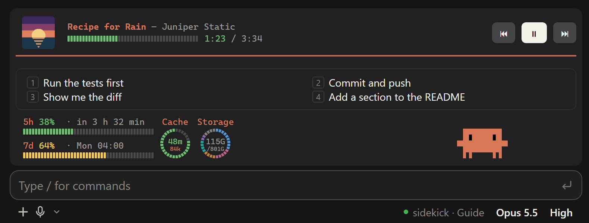
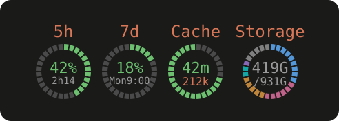
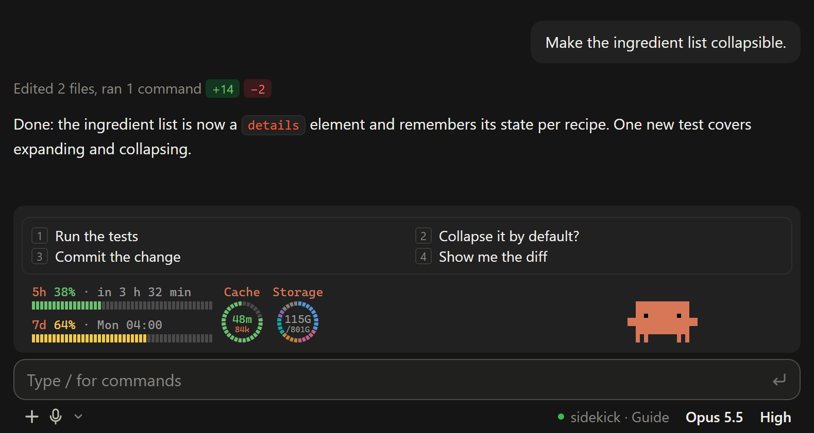

# fynn-mods

**Sechs Mods für Claude Code: ein animiertes Maskottchen, Balken für die Nutzungslimits, ein Sidekick, der vor dem
Senden mitdenkt, Schnellantworten, ein Spotify-Player (Windows) und ein Kostenbuch.**

[](LICENSE)
[](https://github.com/FynnXland/fynn-mods/actions/workflows/checks.yml)
[](https://code.claude.com/docs/de/plugins/mods/overview)
[](#die-mods)
[](#die-mods)

[Installation](#installation) · [Die Mods](#die-mods) · [Fehlerbehebung](#fehlerbehebung) · [English](README.md) · **Deutsch**

<p align="center">
  
  <br><i>spotify, quick-replies, limit-bars und clawd-buddy teilen sich das Band über dem Prompt; sidekick zeigt seine
  Stufe in der Fußzeile. Nachgebaut mit erfundenen Daten. Vier Vorschläge gibt es mit <code>/replies more on</code>; der
  Speicher-Ring ist optional.</i>
</p>

Mein Alltags-Set an [Claude-Code-Mods](https://code.claude.com/docs/de/plugins/mods/overview), also Plugins, die in
die Oberfläche von Claude Code selbst zeichnen, im Terminal und in der Desktop-App. Sie behalten Nutzungslimits,
Prompt-Cache und Kosten im Blick, prüfen Nachrichten vor dem Senden und holen deinen Musik-Player über den Prompt. Die
Mods sind aufeinander abgestimmt, aber jeder ist ein eigenes Plugin und einzeln installierbar.

Dieses Repository ist ein Claude-Code-Plugin-Marketplace mit dem Namen `fynn-mods`.

> **Englisch oder Deutsch.** Alle Mods sprechen standardmäßig Englisch: Knöpfe, Meldungen, Dialoge und die Antworten
> der Modellaufrufe, die manche Mods machen. Jeder Mod hat die Option `language` (`en` oder `de`). Für Deutsch in einer
> Session `/plugin configure <mod>@fynn-mods` aufrufen und `de` wählen. Die Bilder unten zeigen die englische
> Standardeinstellung. Sie sind aus dem Zeichencode der Mods nachgebaut, mit einem erfundenen Beispielprojekt: keine
> echten Chats, Pfade oder Kosten.
> Die Mod-READMEs unter `mods/` sind englisch.

| Mod | In einem Satz |
|---|---|
| [clawd-buddy](#clawd-buddy) | Animiertes Pixel-Maskottchen über dem Prompt, das auf Claudes Arbeit reagiert |
| [limit-bars](#limit-bars) | Balken für das 5-Stunden- und das Wochenlimit, dazu ein Ring, wie lange der Prompt-Cache noch warm ist |
| [sidekick](#sidekick) | Prüft deine Nachricht vor dem Senden: Kosten bei kaltem Cache, falscher Chat, klarere Fassung, fällige Wartung |
| [quick-replies](#quick-replies) | Der Vorschlag von Claude Code für die nächste Nachricht als Knopf |
| [spotify](#spotify) | Spotify-Player über dem Prompt mit Cover, Position und Knöpfen (nur Windows) |
| [cost-ledger](#cost-ledger) | Kostenbuch über alle Chats, nach Tag, Projekt, Chat und Modell |

**Hilfe in jedem Mod:** `/<befehl> help` (`/clawd`, `/bars`, `/sidekick`, `/replies`, `/spotify`, `/ledger`) zeichnet
eine Tabelle mit allen Befehlen, was gerade an oder aus ist und wie man es umschaltet, und den Einstellungen des Mods
mit ihren Werten. In `claude -p` und VS Code kommt dasselbe als kurzer Text.

## Voraussetzungen

- Claude Code mit Mods. Mods brauchen **v2.1.287 oder neuer**; dieses Set ist mit **v2.1.295** getestet. Prüfen mit
  `claude --version`.
- Läuft im Terminal und im Code-Tab der Claude-Desktop-App. In `claude -p`, im Agent SDK, in VS Code und mobil zeichnen
  die meisten Mods nichts; Details in der README des jeweiligen Mods.
- spotify braucht Windows und die Spotify-Desktop-App. Die anderen fünf sind an kein System gebunden (täglich unter
  Windows im Einsatz, in der CI unter Linux getestet); nur der optionale Speicher-Ring von limit-bars läuft nur unter
  Windows.
- Die Mods-API kann sich zwischen Claude-Code-Versionen ändern. Funktioniert ein Mod nach einem Update nicht mehr,
  bitte ein Issue anlegen.

## Installation

Einmal den Marketplace hinzufügen:

```bash
claude plugin marketplace add FynnXland/fynn-mods
```

Dann die gewünschten Mods einzeln installieren:

```bash
claude plugin install clawd-buddy@fynn-mods
claude plugin install limit-bars@fynn-mods
claude plugin install sidekick@fynn-mods
claude plugin install quick-replies@fynn-mods
claude plugin install spotify@fynn-mods        # nur Windows
claude plugin install cost-ledger@fynn-mods
```

In einer Session geht dasselbe mit `/plugin marketplace add FynnXland/fynn-mods` und `/plugin install <mod>@fynn-mods`.
Ein neu installierter Mod lädt in der nächsten Session oder nach `/reload-plugins`. `/plugin` zeigt ihn als
`mod active`.

**Updates:** Jede veröffentlichte Änderung erhöht die Version des Mods. Auto-Update ist für Marketplaces von Dritten
standardmäßig aus. Entweder in `/plugin` unter **Marketplaces** für `fynn-mods` einschalten oder von Hand
aktualisieren:

```bash
claude plugin marketplace update fynn-mods
claude plugin update <mod>@fynn-mods
```

**Entfernen:** in `/plugin` unter **Installed** abschalten oder `claude plugin uninstall <mod>@fynn-mods`.

**Ohne Installation ausprobieren:** das Repo klonen und eine Session mit
`claude --plugin-dir <pfad-zum-klon>/mods/<mod>` starten.

## Kosten

Drei Mods lösen Modellaufrufe **über dein Konto** aus (im Abo zählen sie auf deine Nutzungslimits):

- **sidekick** fragt Haiku 5.5 (Effort `medium`) nur, wenn sich eine Prüfung lohnen kann (erste Nachricht eines Chats,
  großer Kontext, kalter Cache): etwa 0,001 $ und 3 Sekunden je Prüfung (API-Wert). Eine Übergabe in einen neuen Chat
  ist ein größerer Sonnet-Aufruf, nur wenn du ihn wählst. Die Stufe `cache` ruft gar kein Modell auf. `/savings`
  stellt beides der gemessenen Ersparnis gegenüber. Abschalten mit `/sidekick off`. *Gut zu wissen* (standardmäßig
  aus, `/sidekick notes on`) fragt bei längeren Aufgaben das Modell deiner Session, großteils aus dem Cache: etwa
  0,04 $ je Prüfung bei 150k Kontext mit Opus 5.5.
- **quick-replies** forkt die Session nach jeder Antwort **nur mit `/replies more on`** (standardmäßig aus): etwa so
  viel wie eine kurze Antwort, großteils aus dem Prompt-Cache.

limit-bars macht nur einen Aufruf, solange `/keepwarm` läuft (standardmäßig aus). clawd-buddy, spotify und cost-ledger
machen keine Modellaufrufe. cost-ledger bucht die Aufrufe der anderen Mods, so siehst du, was sie kosten.

## Die Mods

### clawd-buddy


Clawd, eine kleine Pixel-Krabbe, sitzt auf der Eingabebox und reagiert auf das, was passiert: Er liest mit, tippt auf
dem Laptop, während Claude Dateien bearbeitet, wartet mit der Sanduhr bei langen Tool-Läufen, jubelt über fertige
Turns und wird sichtbar grantig, wenn sich Fehler häufen. Im Leerlauf vertreibt er sich je nach Tageszeit die Zeit,
nachts schläft er ein. Subagenten erscheinen als kleine Helfer neben ihm.

- **Befehle:** `/clawd` (Status), `/clawd on|off`, `/clawd list`, `/clawd demo <name>`, `/clawd nap`, `/clawd boop`,
  `/clawd help`
- **Rechte kurz:** beobachtet Ereignisse und gibt sie unverändert weiter; zeichnet nur seine eigene Tabelle zu
  `/clawd help`; merkt sich an/aus und ein paar Zähler im eigenen Plugin-Speicher. Keine Dateien, Prozesse, kein Netzwerk, keine Modellaufrufe.
- **Details:** [mods/clawd-buddy](mods/clawd-buddy/README.md) (englisch)

### limit-bars




Zwei schmale Balken links neben Clawd zeigen, wie viel vom 5-Stunden- und vom Wochenlimit verbraucht ist und wann sie
zurückgesetzt werden; in der Desktop-App zeichnet `/bars style ring` sie stattdessen als Ringe. Ein Ring daneben zeigt,
wie lange der Prompt-Cache dieses Chats noch warm ist, dazu die Kontextgröße. Bei Abos, die nur ein Wochenlimit melden,
zeigt die obere Zeile stattdessen dein Wochentempo (`5h ∞ · +12 % über Tempo`, `reicht bis Fr 14:00`), und ein Strich auf
dem Wochenbalken markiert den gleichmäßigen Verbrauch. Die Cache-Wache fragt nach, bevor du in einen großen Chat mit kaltem Cache sendest und damit den ganzen
Kontext neu schreiben würdest.

Ein optionaler dritter Ring zeigt, wie voll ein Laufwerk ist, aufgeteilt nach Dateiart (Programme, Medien, KI-Modelle,
Code …); `/disk` zeigt die Einzelheiten. Er ist **standardmäßig aus** und läuft bisher nur unter Windows: Zum
Einschalten `storagePath` in `/config` setzen.

**Nach deinem Geschmack:** Jeder Teil (5-Stunden-Balken, Wochen-Balken, Cache-Ring, Speicher-Ring) lässt sich einzeln
ausblenden, mit `/bars show cache off` (wirkt sofort in allen offenen Chats) oder dauerhaft über `showFiveHour`,
`showWeekly`, `showCache` und `showStorage` in `/config`. Ohne Cache-Ring bleibt die Rückfrage vor kaltem Senden an;
die schaltest du mit `/cache warn off` ab.

Alle offenen Chats auf demselben Rechner teilen sich den neuesten Limit-Stand und prüfen ihn alle 2 s, die Balken laufen also
ohne Flackern mit.

- **Befehle:** `/cache` (Überblick und Einstellungen), `/handoff [continue|show]` (Übergabe schreiben und in einem
  frischen Chat weitermachen), `/keepwarm [stunden|off]`, `/disk [refresh]`, `/bars [show <teil> on|off | style bar|ring | reset]`, `/bars help`
- **Rechte kurz:** liest Limits, Kontextgröße und Cache-Werte; kann eine Nachricht für eine Rückfrage anhalten; führt
  `/clear` und `/compact` aus und sendet eine Übergabe nur auf deine Wahl; `$.model.fork` nur, solange `/keepwarm`
  läuft; nur mit gesetztem `storagePath` startet er Windows PowerShell mit zwei festen, nur lesenden Skripten
  (Laufwerksgröße, Größen nach Dateiendung); teilt spotify über `$.state` nur mit, wie breit die Balken sind. Keine
  Dateien, kein Netzwerk, keine Umgebungsvariablen.
- **Details:** [mods/limit-bars](mods/limit-bars/README.md) (englisch)

### sidekick

![sidekick in der Desktop-App: unter einer Nachricht schlägt eine blaue sidekick-Zeile /claude-api prompt-audit vor, mit den Knöpfen Copy und ?, die aufgeklappte Erklärung sagt, was das Audit tut und warum es fällig ist; darunter sidekicks Rückfrage bei einer Nachricht in einen kalten, großen Chat: Senden schreibt alles neu für etwa 2,40 $, ein neuer Chat mit Übergabe kostet etwa 0,26 $, mit den Optionen Neuer Chat mit Übergabe, Neuer Chat ohne Übergabe, Trotzdem senden und Abbrechen (englische Einstellung).](assets/sidekick.png)

Ein zweiter Blick auf jede Nachricht, kurz bevor sie rausgeht. Zuerst entscheiden feste Regeln, ohne Kosten. Nur wo
sich eine Prüfung lohnen kann (erste Nachricht eines Chats, großer Kontext, kalter Cache), schaut zusätzlich kurz
Haiku 5.5 drauf. sidekick chattet nie von sich aus: Er bleibt still, setzt eine blaue Hinweiszeile unter deine
Nachricht oder fragt nach.

- **Kalter Cache im großen Chat:** Bevor du einen großen, kalt gewordenen Kontext neu sendest, zeigt er beide Preise,
  etwa „Senden schreibt alles neu (≈ 2,40 $)“ gegenüber „Neuer Chat mit Übergabe (≈ 0,26 $)“. Mit *Neuer Chat mit
  Übergabe* schreibt Sonnet die Übergabe, der Chat wird geleert und deine Nachricht geht im frischen Chat weiter; der
  alte bleibt über `/resume` erreichbar.
- **Ein besserer Weg:** verweist auf einen passenden Skill, schlägt bei neuem Thema einen frischen Chat vor oder bietet
  eine klarere Fassung deiner Nachricht an, die du mit einem Klick sendest.
- **Falscher Chat:** Gehört eine Nachricht klar zu einem anderen Projekt als der Chat, hält sidekick sie an und fragt,
  ob du im falschen Chat bist, bevor sie im falschen Kontext landet (und dort Kosten verursacht).
- **Drei Stufen:** `/sidekick off`, `cache` (nur die Kalt-Rückfrage, kein Modellaufruf) und `guide` (Begleiter, der
  Standard). Ein Label in der Fußzeile neben der Modellauswahl zeigt die Stufe: 🟢 bereit, 🟠 arbeitet oder fragt, 🔴 aus.
  sidekick sendet nie etwas von selbst: Eine klarere Fassung geht nur raus, wenn du sie im Dialog wählst.
- **Fällige Wartung:** Bis zu zweimal pro Chat nennt er einen fälligen Befehl (`/skill-doctor`, Prompt-Audit, Memory
  aufräumen, `/init`), auf Grundlage einer kostenlosen lokalen Schätzung. *In Prompt einfügen* (in der Desktop-App
  *Kopieren*) gibt dir den Befehl zum selbst Senden, und **?** erklärt, warum er gerade fällig ist und was er kostet.
  Nennt eine Hinweiszeile der Nachrichtenprüfung einen Befehl (z. B. `/handoff`), führt ihn ein Knopf mit einem Klick aus.
- **Nachprüfbare Ersparnis:** `/savings` zeigt, was sidekick gekostet und was er messbar gespart hat;
  `/savings detail` ergänzt Rechenweg, Modellvergleich und Verlauf je Tag.
- **Gut zu wissen (optional, standardmäßig aus):** Mit `/sidekick notes on` fragt sidekick bei einer längeren Aufgabe,
  ob du sehr wahrscheinlich etwas mit Folgen übersehen hast, und zeigt es über dem Prompt mit *Erklären*, *Weiß ich schon*
  und *Später*. Meist erscheint nichts.

Scheitert eine Prüfung oder dauert sie zu lange, geht deine Nachricht unverändert raus.

- **Befehle:** `/sidekick` (Status und Einstellungen), `/sidekick off|cache|guide|on`,
  `/sidekick hints …`, `/sidekick notes on|off`, `/sidekick help`,
  `/savings [today|week|all]`, `/savings detail`
- **Rechte kurz:** liest deine Nachricht vor dem Senden; hält sie nur an oder ersetzt sie nur nach deiner Wahl im
  Dialog; Haiku 5.5 und Sonnet 5.5 über `$.model.complete` mit einer laufenden Kurzfassung, deinen letzten 3 Nachrichten und dem Ende von Claudes letzter Antwort, nie dem
  ganzen Verlauf; nur mit Gut zu wissen an eine Frage über `$.model.fork` an das Modell deiner Session über den
  Gesprächsverlauf, mit allen Tools gesperrt; auf Knopfdruck führt er den Befehl der Zeile aus (Befehle aus Plugins und eigene, `/skill-doctor`, `/init`;
  nie MCP-Prompts, `/clear`, `/exit`, `/quit`, `/login`, `/logout`, `/rewind`); zeichnet sein Label in die Fußzeile; füllt
  das leere Eingabefeld mit einem Wartungsbefehl bei *In Prompt einfügen* oder wenn ein Befehl abgelehnt wird; legt ihn
  bei *Kopieren* in die Zwischenablage (`$.ui.copy`);
  liest den Pfad der Projektwurzel; teilt clawd-buddy über `$.state` nur die Art des Ereignisses und die Uhrzeit mit,
  nie deine Nachricht. Keine Dateien, Umgebung, kein Netzwerk, keine Einstellungen.
- **Details:** [mods/sidekick](mods/sidekick/README.md) (englisch)

### quick-replies



Claude Code schlägt oft deine nächste Nachricht als grauen Text im Prompt vor. quick-replies macht daraus einen Knopf
in einer eigenen Pille über Clawd. Ein Klick oder die Taste `1` im leeren Prompt schickt ihn als deine Nachricht ab.
Mit `/replies more on` füllt ein Fork der Session bis zu vier Plätze; Claude Codes eigener Vorschlag bleibt auf `1`.

- **Befehle:** `/replies` (Status), `/replies on|off`, `/replies more on|off`, `/replies help`
- **Rechte kurz:** liest den Vorschlag von Claude Code; sendet einen Vorschlag nur auf Klick oder Taste als deine
  Nachricht, nie automatisch; `$.model.fork` nur mit `more` an. Keine Dateien, Prozesse, kein Netzwerk.
- **Details:** [mods/quick-replies](mods/quick-replies/README.md) (englisch)

### spotify


**Nur Windows.** Ein Spotify-Player im Band über dem Prompt: Albumcover, Titel und Interpret, ein Positionsbalken im
Stil der Limit-Balken und Knöpfe für Neustart/zurück, Abspielen/Pause und weiter. Er liest und steuert die
Spotify-Desktop-App über die Windows-Mediensteuerung: keine Anmeldung, kein Token, kein Netzwerk, keine Spotify-API.
Browser und andere Player bleiben außen vor. In der Desktop-App bekommt er eine eigene Leiste ganz oben im Band, im
Terminal ist er eine Zeile (`♪ Titel – Interpret 1:23/3:45 ⏮ ⏯ ⏭`), die bei schmalem Fenster schrumpft. Mit
`extraButtons` kommen −15 s, +15 s, Zufall und Wiederholen dazu.

- **Befehle:** `/spotify` (läuft gerade), `/spotify play|pause|toggle|next|prev`, `/spotify back|forward`,
  `/spotify shuffle [on|off]`, `/spotify repeat [off|all|track]`, `/spotify size auto|full|compact|mini`,
  `/spotify on|off`, `/spotify help`
- **Rechte kurz:** startet Windows PowerShell 5.1 mit zwei festen Skripten (Spotify-Sitzung lesen; Steuerbefehl
  senden), der Befehl geht nur als Umgebungsvariable hinein; teilt clawd-buddy über `$.state` nur mit, ob Musik läuft,
  ohne Titel oder Interpret; liest, wie breit limit-bars und Clawd sind. Keine Dateien, kein Netzwerk, keine Tokens,
  keine Modellaufrufe.
- **Details:** [mods/spotify](mods/spotify/README.md) (englisch)

### cost-ledger


Nach jeder Antwort bucht cost-ledger, was der Chat bisher gekostet hat (derselbe Wert wie `/cost`), die Tokens je
Modell und die Modellaufrufe anderer Mods. `/ledger` zeigt heute, 7 und 30 Tage und gesamt, einen Verlauf nach Modell,
deine Projekte und die teuersten Chats, gezeichnet im Stil von Claude Code. `/ledger here` zeigt, was dieses Projekt
gekostet hat und welchen Anteil dieser Chat daran hat, in der Desktop-App als Ring. Im Abo zeigt `/ledger limits`, wie viel
API-Wert ins aktuelle 5-Stunden- und Wochenfenster und in deinen Abo-Monat geflossen ist; dein Abo trägst du einmal mit
`/ledger plan` ein. Dazu schätzt es, wie viel von jedem Fenster außerhalb des Ledgers verbraucht wurde (claude.ai, Handy-App, Chats ohne den Mod).

**Mehrere Rechner:** Der Sync ist standardmäßig aus. So siehst du PC und Laptop zusammen in einem `/ledger`:

1. Lege im Cloud-Laufwerk (OneDrive, Dropbox, iCloud Drive, Syncthing …) einen neuen Ordner fest, z. B. `cost-ledger`. Sein Pfad darf auf jedem Rechner anders sein.
2. Auf dem PC: `/ledger sync <vollständiger Pfad zu diesem Ordner>`, danach `/ledger sync name PC`.
3. Sobald das Cloud-Laufwerk den Ordner abgeglichen hat, auf dem Laptop: `/ledger sync <sein Pfad zum selben Ordner>`, danach `/ledger sync name Laptop`.
4. Prüfen: `/ledger sync` listet das andere Gerät, `/ledger` zeigt oben „2 Geräte“.

Der Pfad muss absolut sein, unter Windows mit Laufwerksbuchstaben (z. B. `D:\OneDrive\cost-ledger`; im Explorer per Rechtsklick → **Als Pfad kopieren**);
Netzwerkpfade gehen nicht. In den Ordner kommen nur Zahlen und je Projekt der Ordnername, keine Pfade oder Chat-Titel. Ausführliche
Anleitung mit Pfaden je System und Fehlerhilfe: [Sync between devices](mods/cost-ledger/README.md#sync-between-devices) (englisch).

- **Befehle:** `/ledger`, `/ledger here`, `/ledger weeks`, `/ledger chats|projects|models [7|30|all]`, `/ledger limits`,
  `/ledger plan <abo> <tag|today> [preis]`, `/ledger sync [<ordner>|name <name>|off]`, `/ledger reset`, `/ledger help`
- **Rechte kurz:** liest Kosten, Verbrauch und Limitfenster der Session; beobachtet die Modellaufrufe anderer Mods und
  gibt sie unverändert weiter; speichert Projektname, Git-Remote als `host/owner/repo`, die ersten 50 Zeichen der ersten
  Nachricht eines Chats und deine Abo-Angabe im lokalen Plugin-Speicher. Keine Modellaufrufe, Prozesse oder
  Netzwerkzugriffe. Dateien nur für den optionalen Sync (`$.fs`, begrenzt auf den gewählten Ordner und die eigene Datei `cost-ledger-<id>.json`).
- **Details:** [mods/cost-ledger](mods/cost-ledger/README.md) (englisch)

## Zusammenspiel

- **Ein Band über dem Prompt.** clawd-buddy, limit-bars, quick-replies, spotify und sidekick zeichnen alle ins Band
  über dem Prompt und folgen einer kleinen gemeinsamen Absprache: Limit-Balken und Cache-Ring stehen links neben Clawd,
  die quick-replies-Pille darüber, die spotify-Leiste in der Desktop-App ganz oben (im Terminal ein Platz zwischen den
  Balken und Clawd), und die Boxen von sidekick erscheinen dort nur, solange er etwas zu zeigen hat. Jeder Mod
  funktioniert auch allein.
- **Clawd wippt zur Musik.** Läuft spotify, nickt Clawd im Takt, wenn er Zeit hat, und setzt manchmal Kopfhörer auf.
  spotify verrät ihm nur, *dass* Musik läuft, nie was.
- **limit-bars und sidekick warnen beide vor kaltem Senden.** Nutzt du beide, schalte die Warnung von limit-bars
  einmal mit `/cache warn off` ab, damit nicht zwei Dialoge hintereinander kommen; die Rückfrage von sidekick ersetzt
  sie.
- **Clawd spielt sidekick mit.** Sind beide installiert, hält Clawd die Lupe ans Eingabefeld, während sidekick prüft,
  zeigt bei einer Rückfrage ein Stoppschild und schreibt einen Brief, wenn sidekick einen neuen Chat mit Übergabe
  startet.
- **cost-ledger bucht die anderen.** Modellaufrufe von sidekick, quick-replies und limit-bars stehen nicht in
  `/cost`; cost-ledger bucht sie getrennt, so zeigt `/ledger`, was jeder Mod kostet.

## Rechte und Vertrauen

Ein Mod ist Code, der in Claude Code mit deinen Rechten läuft. Jeder Mod hier legt offen, an welche Ereignisse er sich
hängt und welche API-Aufrufe er macht; `claude plugin validate mods/<mod>` zeigt die genaue Liste, und jede README
erklärt in Klartext, wofür sie da sind. Keiner dieser Mods liest oder speichert Anmeldedaten oder Tokens, keiner hat einen
eigenen Netzwerkzugang, und keiner schreibt irgendwohin außer in seinen eigenen Plugin-Speicher; einzige Ausnahme: cost-ledger schreibt seine eigene Datei in den Ordner, den du wählst, aber nur, wenn du `/ledger sync` einschaltest. Zwei Mods
starten Prozesse, beide nur Windows PowerShell mit festen Skripten: spotify, um die Spotify-Sitzung der
Windows-Mediensteuerung zu lesen und zu steuern (keine Dateien, kein Netzwerk), und limit-bars nur für den optionalen
Speicher-Ring. Dieser Ring ist auch das Einzige, was auf dein Laufwerk schaut: Er liest Größen, nie Dateiinhalte. Sicherheitsproblem
gefunden? Siehe [SECURITY.md](SECURITY.md) (englisch).

## Fehlerbehebung

| Problem | Lösung |
|---|---|
| Ein Mod zeichnet nichts | `claude --version` prüfen (Mods brauchen v2.1.287 oder neuer) und ob `/plugin` den Mod als `mod active` zeigt. Ein neu installierter Mod lädt in der nächsten Session oder nach `/reload-plugins`. In `claude -p`, im Agent SDK, in VS Code und mobil zeichnen die meisten Mods nichts. |
| Nach einem Claude-Code-Update geht ein Mod nicht mehr | Die Mods aktualisieren (`claude plugin marketplace update fynn-mods`, dann `claude plugin update <mod>@fynn-mods`). Hilft das nicht, bitte ein Issue anlegen. |
| Zwei Rückfragen hintereinander vor dem Senden mit kaltem Cache | limit-bars und sidekick fragen beide vor dem Senden mit kaltem Cache nach. Die Rückfrage von limit-bars mit `/cache warn off` abschalten. |
| Alles ist englisch | Die Option `language` mit `/plugin configure <mod>@fynn-mods` auf `de` stellen. |
| spotify zeigt nichts | Er läuft nur unter Windows und braucht die Spotify-Desktop-App (der Web-Player wird nicht erkannt). Ist Spotify geschlossen, zeichnet er nichts; `/spotify` sagt, was er sieht. Falls ausgeschaltet: `/spotify on`. |
| Der Speicher-Ring fehlt oder bleibt leer | Er läuft nur unter Windows und ist standardmäßig aus: `storagePath` (z. B. `D:\`) in `/config` setzen und prüfen, ob `/bars show storage on` gilt. Bleibt er leer, zeigt `/disk` den Fehler. |
| cost-ledger zeigt einen Chat mit Haiku 5.5 etwa zehnfach zu teuer an | Claude Code v2.1.291 berechnete Haiku 5.5 in `/cost` wie Haiku 4.5, und cost-ledger bucht diesen Wert für den Chat. Claude Code aktualisieren; v2.1.295 rechnet richtig. Modellaufrufe der Mods rechnet cost-ledger mit eigenen Preisen. |

Warum ein Mod nichts tut, zeigt das Debug-Log: Claude Code mit `claude --debug-file mod-debug.log` starten und die
Datei nach dem Namen des Mods durchsuchen ([Doku von Claude Code](https://code.claude.com/docs/de/plugins/mods/troubleshoot)).

## Feedback

Fehlerberichte und Ideen gern als [Issue](https://github.com/FynnXland/fynn-mods/issues), gern auch auf Deutsch; das
Formular fragt nach der Version des Mods (`/plugin`), `claude --version` und Terminal oder Desktop-App. Bevor du einen
Pull Request anfängst, lies bitte [CONTRIBUTING.md](CONTRIBUTING.md) (englisch).

## Hinweis

Das ist ein inoffizielles Hobbyprojekt, nicht von Anthropic erstellt, unterstützt oder geprüft. clawd-buddy ist eine
Fan-Hommage an Clawd, das Maskottchen von Claude Code; die Pixel sind von Hand gezeichnet. Hat Anthropic Einwände, wird
der Mod entfernt. Spotify ist eine Marke der Spotify AB; der Mod spotify stammt nicht von Spotify und spricht nur über
Windows mit der Spotify-Desktop-App.

## Lizenz

[MIT-Lizenz](LICENSE), Copyright (c) 2026 Fynn Hansen. Rechtlich maßgeblich ist der englische Lizenztext. Sofern du
nicht ausdrücklich etwas anderes angibst, steht jeder Beitrag, den du zur Aufnahme in dieses Projekt einreichst, unter
der MIT-Lizenz, ohne zusätzliche Bedingungen.

limit-bars ist nach Cache Keeper von Nate Herk gebaut (MIT); sidekick übernimmt die Cache-Logik von limit-bars. Siehe
die `THIRD-PARTY-NOTICES.md` in beiden Mods.
