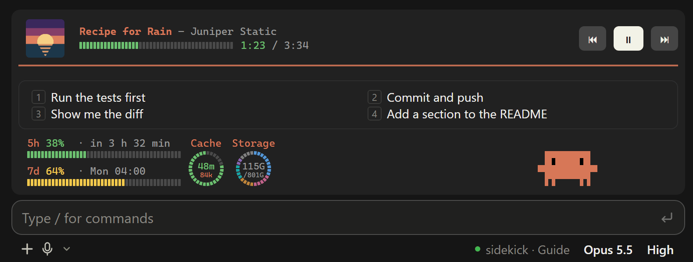
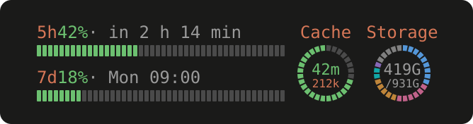
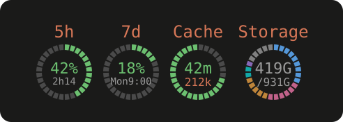
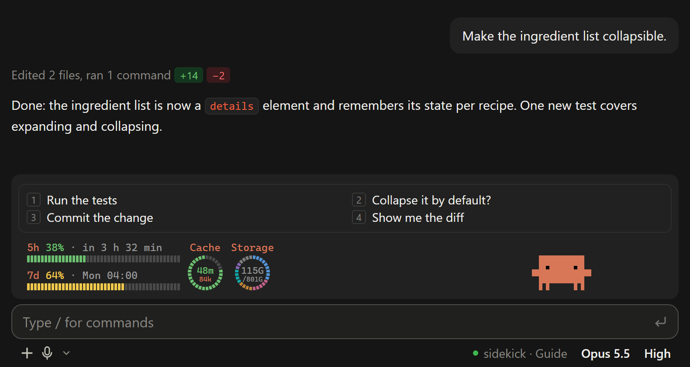

# fynn-mods

**Six mods for Claude Code: an animated mascot, usage-limit bars, a pre-send sidekick, quick replies, a music bar
for Spotify (Windows) and a cost ledger.**

[](LICENSE)
[](https://github.com/FynnXland/fynn-mods/actions/workflows/checks.yml)
[](https://code.claude.com/docs/en/plugins/mods/overview)
[](#the-mods)
[](#the-mods)

[Install](#installation) · [The mods](#the-mods) · [Troubleshooting](#troubleshooting) · **English** · [Deutsch](README.de.md)

<p align="center">
  
  <br><i>tune-strip, quick-replies, limit-bars and clawd-buddy share the band above the prompt; sidekick shows its level
  in the footer. Rebuilt with invented data. Four suggestions need <code>/replies more on</code>; the storage ring is
  optional.</i>
</p>

My daily-driver set of [Claude Code mods](https://code.claude.com/docs/en/plugins/mods/overview), the plugins that
draw into Claude Code's own interface in the terminal and in the desktop app. They keep an eye on usage limits, the
prompt cache and costs, check messages before they go out and put your music player above the prompt. The mods are
tuned to work side by side, but each one is a separate plugin you can install on its own.

This repository is a Claude Code plugin marketplace named `fynn-mods`.

> **English or German.** Every mod speaks English by default: buttons, messages, dialogs and the answers of the model
> calls some mods make. Each mod has a `language` option (`en` or `de`). `/clawd language de` (or the same with
> `/bars`, `/sidekick`, `/replies`, `/tune`, `/ledger`) switches all installed fynn-mods at once; for one mod only,
> use `/plugin configure <mod>@fynn-mods`. The pictures below show the English default. They are rebuilt
> from the mods' own drawing code with an invented sample project, so no real chats, paths or costs appear.

| Mod | In one line |
|---|---|
| [clawd-buddy](#clawd-buddy) | Animated pixel mascot above the prompt that reacts to what Claude is doing |
| [limit-bars](#limit-bars) | 5-hour and weekly limit bars, a ring showing how long the prompt cache stays warm, optional cost ring and system values |
| [sidekick](#sidekick) | Checks your message before it is sent: cold-cache costs, wrong chat, better wording, due maintenance |
| [quick-replies](#quick-replies) | Claude Code's next-message suggestion as a one-click button |
| [tune-strip](#tune-strip) | Music bar for Spotify above the prompt with cover, position and controls (Windows only) |
| [cost-ledger](#cost-ledger) | Cost ledger across all chats, by day, project, chat and model |

**Help in every mod:** `/<command> help` (`/clawd`, `/bars`, `/sidekick`, `/replies`, `/tune`, `/ledger`) draws a
table of all commands, what is on or off right now and how to switch it, and the mod's settings with their values.
In `claude -p` and VS Code you get the same as short text.

## Requirements

- Claude Code **v2.1.309 or later** (older versions refuse to load these mods); tested with **v2.1.318**. Check with
  `claude --version`.
- Runs in the terminal and in the Code tab of the Claude desktop app. In `claude -p`, the Agent SDK, VS Code and on
  mobile most mods draw nothing; see each mod's README.
- tune-strip needs Windows and the Spotify desktop app. The other five are not tied to one system (used daily on
  Windows, tested on Linux in CI); limit-bars' optional storage ring and system values are Windows only.
- The mods API can change between Claude Code releases. If a mod breaks after an update, please open an issue.

## Installation

Add the marketplace once:

```bash
claude plugin marketplace add FynnXland/fynn-mods
```

Then install the mods you want, one by one:

```bash
claude plugin install clawd-buddy@fynn-mods
claude plugin install limit-bars@fynn-mods
claude plugin install sidekick@fynn-mods
claude plugin install quick-replies@fynn-mods
claude plugin install tune-strip@fynn-mods     # Windows only
claude plugin install cost-ledger@fynn-mods
```

Inside a session the same works with `/plugin marketplace add FynnXland/fynn-mods` and `/plugin install <mod>@fynn-mods`.
A newly installed mod loads in the next session, or after `/reload-plugins`. `/plugin` lists it as `mod active`.

**Updates:** Every published change bumps the mod's version. Auto-update is off for third-party marketplaces by default.
Either turn it on for `fynn-mods` under **Marketplaces** in `/plugin`, or update by hand:

```bash
claude plugin marketplace update fynn-mods
claude plugin update <mod>@fynn-mods
```

**Remove:** disable a mod under **Installed** in `/plugin`, or run `claude plugin uninstall <mod>@fynn-mods`.

**Try without installing:** clone this repo and start a session with `claude --plugin-dir <path-to-clone>/mods/<mod>`.

## Costs

Three mods make model calls **on your account** (on a subscription they count toward your usage limits):

- **sidekick** asks Haiku 5.5 (effort `medium`) only when a check can pay off (first message of a chat, large context,
  cold cache): about $0.001 and 3 seconds per check (API value). A handoff to a new chat is one larger Sonnet call,
  made only when you choose it. Level `cache` makes no model call at all. `/savings` sets both against the measured
  savings. Turn it off with `/sidekick off`. *Good to know* (off by default, `/sidekick notes on`) asks your session's
  own model during longer tasks, mostly from the cache: about $0.04 per check at 150k context with Opus 5.5.
- **quick-replies** forks the session after each answer **only with `/replies more on`** (off by default): roughly
  the cost of one short answer, mostly from the prompt cache.

limit-bars makes a call only while you have `/keepwarm` running (off by default). clawd-buddy, tune-strip and cost-ledger
make no model calls. cost-ledger records the calls of the other mods, so you can see what they cost.

## The mods

### clawd-buddy


Clawd, a little pixel crab, sits on top of the prompt box and reacts to what's going on: he reads along, types on a
laptop while Claude edits, waits with an hourglass during long tool runs, celebrates finished turns and gets visibly
grumpy when errors pile up. When idle he passes the time depending on the hour, and at night he falls asleep.
Subagents show up as small helpers next to him.

With [tune-strip](#tune-strip) playing, he nods on the actual beat of the song and picks his moves by its sound: he
sways to calm songs, snaps his fingers to groove and hip-hop, plays air guitar to hard songs and waves a lighter to sad
ballads. In the desktop app he walks behind the row of the band, so wide limit bars don't push him aside.

- **Commands:** `/clawd` (status), `/clawd on|off`, `/clawd list`, `/clawd demo <name>`, `/clawd nap`, `/clawd boop`,
  `/clawd language de|en`, `/clawd help`
- **Rights in short:** observes events and passes them on unchanged; draws only its own `/clawd help` table;
  remembers on/off and a few counters in its own plugin store; reads from tune-strip whether music is playing, the
  tempo and the group of the song, never the title. Besides that only the [language switch](#rights-and-trust). No
  files, network or model calls.
- **Details:** [mods/clawd-buddy](mods/clawd-buddy/README.md)

### limit-bars





Two slim bars left of Clawd show how much of the 5-hour and the weekly limit you've used and when each resets; in the
desktop app `/bars style ring` draws them as rings instead. A ring next to them shows how long this chat's prompt
cache stays warm, and the context size. On plans that report only a weekly limit, the top line shows your weekly
pace instead (`5h ∞ · +12% pace`, `lasts until Fri 14:00`), and a line on the weekly bar marks even use. The cache guard asks before
you send into a large chat with a cold cache, which would re-write the whole context.

An optional third ring shows how full a drive is, split by file type (programs, media, AI models, code …), with
`/disk` for the details. It is **off by default** and Windows only for now: set `storagePath` in `/config` to turn it on.

With [cost-ledger](#cost-ledger) installed, a cost ring shows what this chat cost as a share of the whole project, in
API value. `/bars show cpu on` adds live system values (CPU, RAM, GPU load and GPU memory, one reading per second, each
with a trend arrow); they are **off by default** and Windows only. GPU load works with any card whose driver provides the
Windows GPU counters; GPU memory needs an NVIDIA card.

**Make it yours:** every part (5-hour bar, weekly bar, cache ring, storage ring, cost ring, system values) can be hidden
on its own, with `/bars show cache off` (applies to all open chats right away) or permanently with `showFiveHour`,
`showWeekly`, `showCache`, `showStorage`, `showCost` and `showSystem` in `/config`. Hiding the cache ring keeps the cold-send question; turn that off with
`/cache warn off`.

Every open chat on the same computer shares the newest limit reading and checks it every 2 s, so the bars follow along
without flicker.

- **Commands:** `/cache` (overview and settings), `/handoff [continue|show]` (write a handoff and continue in a fresh
  chat), `/keepwarm [hours|off]`, `/disk [refresh]`, `/bars [show <part> on|off | style bar|ring | reset]`,
  `/bars language de|en`, `/bars help`
- **Rights in short:** reads limits, context size and cache statistics; can hold a message back to ask you first; runs
  `/clear` and `/compact` and sends a handoff only after you choose so; `$.model.fork` only while `/keepwarm` runs;
  only with `storagePath` set, runs Windows PowerShell with two fixed, read-only scripts (drive size, sizes by file
  extension); only with the system values on, one Windows PowerShell process with a fixed, read-only script (and
  `nvidia-smi`); reads the chat and project cost from cost-ledger and sidekick's level, and tells tune-strip only how
  wide the bars are (`$.state`). Besides that only the [language switch](#rights-and-trust). No files, network or environment variables.
- **Details:** [mods/limit-bars](mods/limit-bars/README.md)

### sidekick


A second pair of eyes on every message, right before it is sent. Fixed rules decide first, at no cost. Only where a
check can pay off (the first message of a chat, a large context, a cold cache) a quick Haiku 5.5 call looks at it
too. sidekick never chats on its own: it stays quiet, adds a blue hint line under your message, or asks you.

- **Cold cache in a large chat:** before you resend a big context that has gone cold, it shows both prices, e.g.
  "sending rewrites everything (≈ $2.40)" versus "new chat with handoff (≈ $0.26)". With *new chat with handoff*,
  Sonnet writes the handoff, the chat is cleared and your message continues in the fresh one; the old chat stays
  available in `/resume`.
- **A better move:** points to a matching skill, suggests a fresh chat when the topic has changed, or offers a clearer
  version of your message that you can send with one click.
- **Wrong chat:** if a message clearly belongs to a different project than the chat, sidekick holds it back and asks
  whether you're in the wrong chat, before it lands in (and pays for) the wrong context.
- **Three levels:** `/sidekick off`, `cache` (only the cold-cache question, no model call) and `guide` (the default). A label in the prompt footer next to the
  model picker shows the level: 🟢 ready, 🟠 working or asking, 🔴 off. sidekick never sends anything on its own: a
  clearer version only goes out if you choose it in the dialog.
- **Due maintenance:** up to twice per chat it names one due command (`/skill-doctor`, prompt audit, memory
  consolidation, `/init`), based on a free local estimate. **Insert in prompt** (in the desktop app **Copy**) hands you
  the command to send yourself, and **?** explains why it is due now and what it costs. A command named in a hint
  line from the message check (e.g. `/handoff`) gets a button that runs it with one click.
- **Savings you can check:** `/savings` shows what sidekick cost and what it measurably saved; `/savings detail` adds
  the calculation, a model comparison and a day-by-day history.
- **Good to know (optional, off by default):** with `/sidekick notes on`, sidekick asks during a longer task whether
  you very likely missed something with consequences, and shows it above the prompt with *Explain*, *Know this* and
  *Later*. Most of the time nothing appears.
- **Model tip:** on the first message of a chat on Opus or Fable, sidekick asks whether a simple task should run on
  Sonnet 5.5 or Haiku 5.5. With `/sidekick tips auto on` (off by default) it also switches built-in subagents and
  chats Claude starts when Haiku rates their task simple. `/savings` shows the savings as a marked estimate.

If a check fails or times out, your message goes through unchanged.

- **Commands:** `/sidekick` (status and settings), `/sidekick off|cache|guide|on`,
  `/sidekick hints …`, `/sidekick notes on|off`, `/sidekick tips …`, `/sidekick language de|en`, `/sidekick help`,
  `/savings [today|week|all]`, `/savings detail`
- **Rights in short:** reads your message before it is sent; holds it back or replaces it only after your choice in
  the dialog; Haiku 5.5 and Sonnet 5.5 via `$.model.complete` with a short running summary, your last 3 messages and the end of Claude's last reply, never the whole
  history; only with Good to know on, one question via `$.model.fork` to your session's own model over the
  conversation, with every tool denied; on a button click it runs the command shown in the line (plugin and your own commands, `/skill-doctor`,
  `/init`; never MCP prompts, `/clear`, `/exit`, `/quit`, `/login`, `/logout`, `/rewind`); draws its label in the prompt footer; fills
  the empty prompt with a maintenance command on *Insert in prompt* or if a command is refused; copies it to the
  clipboard on *Copy* (`$.ui.copy`); reads the project root path; tells clawd-buddy via `$.state` only the kind of
  event and the time, never your message. For the model tip it reads the main model (`$.session.model`), changes the
  model per request only in a chat where you picked a cheaper one, and, with `tips auto` on, sets the model of
  built-in subagents (`agent.spawn`) and of `start_session` and shows a line in the agent's window (`$.ui.notice`).
  Besides that only the [language switch](#rights-and-trust). No files, environment or network.
- **Details:** [mods/sidekick](mods/sidekick/README.md)

### quick-replies



Claude Code often suggests your next message as grey text in the prompt. quick-replies turns it into a button in its
own pill above Clawd. Click it, or type `1` into the empty prompt, and it's sent as your message. With
`/replies more on` a fork of the session fills up to four places in total; Claude Code's own stays on `1`.

- **Commands:** `/replies` (status), `/replies on|off`, `/replies more on|off`, `/replies language de|en`,
  `/replies help`
- **Rights in short:** reads Claude Code's suggestion; sends a suggestion as your message only on click or key, never
  automatically; `$.model.fork` only with `more` on; tells tune-strip only whether the pill is up (`$.state`), never
  its text. Besides that only the [language switch](#rights-and-trust). No files or network.
- **Details:** [mods/quick-replies](mods/quick-replies/README.md)

### tune-strip


**Windows only.** A music bar for Spotify in the band above the prompt: album cover, title and artist, a position bar in the
style of the limit bars, and buttons for restart/previous, play/pause and next. It reads and controls the Spotify
desktop app through the Windows media controls: no login, no token, no network, no Spotify API. Browsers and other
players are ignored. In the desktop app it gets its own bar on top of the band; in the terminal it is one line
(`♪ Title – Artist 1:23/3:45 ⏮ ⏯ ⏭`) that shrinks when the window gets narrow. With `extraButtons` the bar adds
−15 s, +15 s, shuffle and repeat.

**Beat for Clawd:** while Spotify plays, tune-strip finds the tempo and the beats of the song and whether it sounds
calm, groove/hip-hop, hard or sad, so [Clawd](#clawd-buddy) can move in time. Only Spotify's own audio is listened to
(Windows process loopback), never the rest of the system sound. **It is analysed locally for tempo only; nothing is
recorded, stored or sent.** `/tune beat off` turns it off, `/tune beat offset <ms>` shifts the beat for headphones.

- **Commands:** `/tune` (now playing), `/tune play|pause|toggle|next|prev`, `/tune back|forward`,
  `/tune shuffle [on|off]`, `/tune repeat [off|all|track]`, `/tune size auto|full|compact|mini`,
  `/tune on|off`, `/tune beat [on|off|offset <ms>]`, `/tune language de|en`, `/tune help`
- **Rights in short:** starts Windows PowerShell 5.1 with two fixed scripts (read the Spotify session; send a control
  command), with the command passed only as an environment variable; while Spotify plays and the band is on screen,
  one beat helper (PowerShell with a fixed text, only numbers on its output); tells clawd-buddy via `$.state` whether
  music is playing, the tempo, the beat time and the group, no title or artist; reads how wide limit-bars and Clawd
  are and whether quick-replies shows its pill. Besides that only the [language switch](#rights-and-trust). No files,
  network, tokens or model calls.
- **Renamed:** up to 0.3.1 this mod was called `spotify` with the command `/spotify`. To switch, run
  `claude plugin marketplace update fynn-mods` and then once `claude plugin install tune-strip@fynn-mods`; the
  marketplace maps the old name to the new one, so your settings move over.
- **Details:** [mods/tune-strip](mods/tune-strip/README.md)

### cost-ledger


After every answer cost-ledger books what the chat has cost so far (the same figure as `/cost`), the tokens per model
and the model calls made by other mods. `/ledger` shows today, 7 and 30 days and the total, a history split by model,
your projects and the most expensive chats, drawn in Claude Code's own style. `/ledger here` shows what this project
has cost and this chat's share of it, as a ring in the desktop app. On a subscription, `/ledger limits` shows
how much API value went into the current 5-hour and weekly window and into your subscription month; set your plan once
with `/ledger plan`. It also estimates how much of each window you used outside the ledger (claude.ai, the mobile app, chats without the mod).

**Several computers:** sync is off by default. To see your PC and your laptop together in one `/ledger`:

1. Pick a new folder in your cloud drive (OneDrive, Dropbox, iCloud Drive, Syncthing …), e.g. `cost-ledger`. Its path may differ per computer.
2. On the PC: `/ledger sync <full path to that folder>`, then `/ledger sync name PC`.
3. Once your cloud drive has synced the folder, on the laptop: `/ledger sync <its path to the same folder>`, then `/ledger sync name Laptop`.
4. Check: `/ledger sync` lists the other device, and `/ledger` shows “2 devices” at the top.

The path must be absolute, on Windows with a drive letter (e.g. `D:\OneDrive\cost-ledger`; in File Explorer, right-click → **Copy as path**); network
paths do not work. Only numbers and each project’s folder name go into the folder, no paths or chat titles. Full guide with paths per system and
troubleshooting: [Sync between devices](mods/cost-ledger/README.md#sync-between-devices).

- **Commands:** `/ledger`, `/ledger here`, `/ledger weeks`, `/ledger chats|projects|models [7|30|all]`, `/ledger limits`,
  `/ledger plan <plan> <day|today> [price]`, `/ledger sync [<folder>|name <name>|off]`, `/ledger reset`,
  `/ledger language de|en`, `/ledger help`
- **Rights in short:** reads the session's cost, usage and limit windows; observes other mods' model calls and passes
  them on unchanged; stores the project name, the git remote as `host/owner/repo`, the first 50 characters of a chat's
  first message and your plan setting in its local plugin store; shares this chat's and this project's cost with
  limit-bars (`$.state`, amounts and the folder name only). Besides that only the [language switch](#rights-and-trust).
  Makes no model calls or network access. Files only for the optional sync (`$.fs`, limited to the folder you set and to its own `cost-ledger-<id>.json` files).
- **Details:** [mods/cost-ledger](mods/cost-ledger/README.md)

## How they work together

- **One band above the prompt.** clawd-buddy, limit-bars, quick-replies, tune-strip and sidekick all draw into the band
  above the prompt and share a small layout convention: the limit bars and cache ring sit left of Clawd, the
  quick-replies pill sits above both, tune-strip's bar sits on top in the desktop app (in the terminal it takes a place
  between the bars and Clawd), and sidekick's boxes appear there only while it has something to show. In the desktop
  app Clawd walks behind the row, and the bars and tune-strip are drawn on top of him. Each mod also works alone.
- **Clawd moves to your music.** With tune-strip playing, Clawd nods on the beat of the song when he has time, picks
  his moves by how it sounds and sometimes puts on headphones. tune-strip tells him only that music is playing, the
  tempo and the group (calm, groove, hard, sad), never what is playing.
- **cost-ledger feeds limit-bars.** With both installed, limit-bars draws a cost ring with what this chat and this
  project cost, the same numbers as `/ledger here all`.
- **One language switch for all.** `/<command> language de|en` in any of the six mods switches every installed
  fynn-mod at once.
- **limit-bars steps aside for sidekick.** Both can ask before a cold send. While sidekick runs on `cache` or `guide`,
  limit-bars stays quiet by itself (`/cache` shows "on (sidekick is asking right now)"), so you never get two dialogs
  in a row.
- **Clawd acts out what sidekick does.** With both installed, Clawd holds a magnifying glass to the input while
  sidekick checks, holds up a stop sign when it asks, and writes a letter when it starts a new chat with a handoff.
- **cost-ledger books the others.** Model calls of sidekick, quick-replies and limit-bars don't show up in
  `/cost`; cost-ledger records them separately, so `/ledger` shows what each mod costs.

## Rights and trust

A mod is code that runs inside Claude Code with your permissions. Every mod here declares what it hooks into and which
API calls it makes; `claude plugin validate mods/<mod>` prints the exact list, and each README explains in plain
language what they are for. None of these mods reads or stores login data or tokens, none has network access of its own, and
none writes anywhere but its own plugin store, with two exceptions: cost-ledger writes its own file into the folder you
choose, but only if you turn on `/ledger sync`; and the language switch changes the `language` setting of the six
fynn-mods, nothing else.

**Language switch:** `/<command> language de|en` reads the plugin settings and changes only the `language` field of
the six fynn-mods (`$.config`). In the desktop app and `claude -p`, where Claude Code lists no plugin settings, it runs
the `claude` CLI instead, only `claude plugin list --json` and `claude plugin configure <mod>@fynn-mods` for the six
fynn-mods. That is the only process clawd-buddy, cost-ledger, quick-replies and sidekick ever start.

**Other processes,** all Windows PowerShell with fixed scripts: tune-strip, to read and control the Spotify session of
the Windows media controls and, for the beat, to listen to Spotify's audio only (tempo only, nothing recorded, no files,
no network); limit-bars, only for its optional storage ring and system values. The storage ring is also the only thing
that looks at your drive: it reads sizes, never file contents. Found a security problem? See [SECURITY.md](SECURITY.md).

## Troubleshooting

| Problem | Fix |
|---|---|
| A mod draws nothing | Check `claude --version` (these mods need v2.1.309 or later) and that `/plugin` lists the mod as `mod active`. A newly installed mod loads in the next session or after `/reload-plugins`. In `claude -p`, the Agent SDK, VS Code and on mobile most mods draw nothing. |
| A mod broke after a Claude Code update | Update the mods (`claude plugin marketplace update fynn-mods`, then `claude plugin update <mod>@fynn-mods`). If that doesn't help, please open an issue. |
| Two questions in a row before a cold send | Update limit-bars to 0.14.0 or later; it then leaves the question to sidekick. With an older limit-bars, turn off its question with `/cache warn off`. |
| Everything is in English | `/clawd language de` (or any other mod's command) switches all fynn-mods; for one mod, set `language` to `de` with `/plugin configure <mod>@fynn-mods`. In the desktop app it applies from the next chat, or at once after `/reload-plugins`. |
| tune-strip shows nothing | It is Windows only and needs the Spotify desktop app (the web player is not recognized). While Spotify is closed it draws nothing; `/tune` tells you what it sees. `/tune on` if you turned it off. |
| The storage ring is missing or empty | It is Windows only and off by default: set `storagePath` (for example `D:\`) in `/config`, and check that `/bars show storage on` is set. If it stays empty, `/disk` shows the error. |
| cost-ledger shows a Haiku 5.5 chat at about ten times its cost | Claude Code v2.1.291 priced Haiku 5.5 like Haiku 4.5 in `/cost`, and cost-ledger books that value for the chat. Update Claude Code; v2.1.295 prices it correctly. Model calls of the mods use cost-ledger's own prices. |

To see why a mod does nothing, start Claude Code with `claude --debug-file mod-debug.log` and search the file for the
mod's name ([Claude Code docs](https://code.claude.com/docs/en/plugins/mods/troubleshoot)).

## Feedback

Bug reports and ideas are welcome as [issues](https://github.com/FynnXland/fynn-mods/issues); the form asks for the
mod's version (`/plugin`), `claude --version`, and whether it happened in the terminal or the desktop app. Before you
start on a pull request, please read [CONTRIBUTING.md](CONTRIBUTING.md).

## Disclaimer

This is an unofficial hobby project. It is not made, endorsed or supported by Anthropic. clawd-buddy is a fan homage
to Clawd, the Claude Code mascot; the pixels are drawn by hand. If Anthropic objects to it, it will be removed.
Spotify is a trademark of Spotify AB; the tune-strip mod is not made or endorsed by Spotify and only talks to the Spotify
desktop app through Windows.

## License

[MIT License](LICENSE), Copyright (c) 2026 Fynn Hansen. Unless you explicitly state otherwise, any contribution you
submit for inclusion in this project is licensed under the MIT License, without additional terms or conditions.

limit-bars is modeled on Cache Keeper by Nate Herk (MIT); sidekick reuses limit-bars' cache logic. See the
`THIRD-PARTY-NOTICES.md` in both mods.
